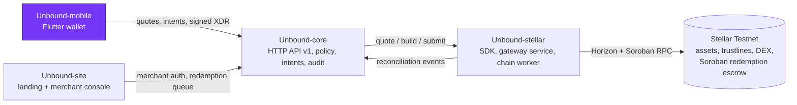

<div align="center">


# Unbound-mobile

**The Unbound consumer wallet for Android and iOS: hold issuer-authorized store credit, review a real quote, check the transaction on your own device, then sign.**

[](https://github.com/Unbound224/Unbound-mobile/actions/workflows/ci.yml)
[](./LICENSE)
[](https://developers.stellar.org/docs/networks)
[](#tech-stack)

[Live site](https://unbound-web1.vercel.app) · [Docs](https://github.com/Unbound224/Unbound-site/tree/main/gitbook) · [Download the Android beta](https://github.com/Unbound224/Unbound-mobile/releases/latest/download/unbound-android.apk) · [Quick start](#quick-start) · [Contributing](./CONTRIBUTING.md)

<p>
  
  
  
</p>
<sub>Headless renders of the real screens with synthetic Testnet fixtures (<code>tool/screenshots</code>), not device captures.</sub>

</div>

## What this is

Store credit is usually stuck inside one retailer. Unbound lets a person exchange store credit that a retailer has issued and
agreed to honor for other Stellar assets, at a real order-book quote that they sign on their own device, or redeem it with the issuer.
This app is the consumer side. It keeps the user's Testnet key in the platform keystore and never sends it anywhere. It shows credit
with the issuer and redemption terms, asks for a quote, **decodes the unsigned transaction locally and checks it against the quote**
before asking for biometric approval and signing, and tracks each exchange and redemption honestly: pending, reconciling, confirmed or
failed, even across restarts.

Unbound is a Testnet prototype. It has had no security audit and holds no real funds.

## Status

| Piece | State |
|---|---|
| Pure rules: exact `Amount`, strict contract models, quote review with a re-derived slippage floor, inventory, status text | Built and tested |
| Local XDR inspection: the unsigned envelope is decoded and compared with the quote before signing | Built; tested on real XDR from `Unbound-stellar`'s builders |
| Escrowed redemptions: local decode of the Soroban `open_return` and `expire_refund` calls (contract, function, wallet, issuer, amount, deadline), escrow card, Check status, Take my credit back | Built; tested with real XDR. The contract it targets is [deployed on Testnet](https://stellar.expert/explorer/testnet/contract/CC4ETHM44IUJ4GDRT57VH4OSNEMPEGUKQHQJCUQDIU2LKIAKZYIYOP6C), but the app itself has **not** been run against it |
| Key storage (Android Keystore, iOS Keychain), biometric approval, Testnet only | Built; Dart signatures match the TypeScript fixtures byte for byte; **not verified on a device** |
| Wallet backup (recovery key behind acknowledgement and device approval) and restore | Built and tested; screenshot blocking (`FLAG_SECURE`) on Android built but **not verified on a device**; iOS has no equivalent |
| Screens: wallet gate, inventory, exchange, quote review with countdown, status, redemption, settings | Built; widget-tested including expiry, refusal, cancel and unknown outcomes |
| `flutter build apk --release` | Succeeds (about 52 MB, debug-signed unless signing secrets exist); never installed on a phone or emulator |
| Release workflow (`v*` tag to a GitHub release with `unbound-android.apk` and a checksum) | Written and guarded by a test; see the latest release for its first run |
| Device and integration tests, TalkBack and VoiceOver audit, localisation, push notifications | Not done |
| App Store and Google Play listings | None: the app is not in any store |

## How it fits together



The app never builds a Stellar transaction. It receives an unsigned one from core, checks it, and returns the signature.

| Repository | Owns | CI |
|---|---|---|
| [Unbound-core](https://github.com/Unbound224/Unbound-core) | Backend API: issuers, policies, intents, redemptions, audit | [](https://github.com/Unbound224/Unbound-core/actions/workflows/ci.yml) |
| [Unbound-stellar](https://github.com/Unbound224/Unbound-stellar) | Stellar SDK, gateway service, chain worker, Soroban escrow | [](https://github.com/Unbound224/Unbound-stellar/actions/workflows/ci.yml) |
| [Unbound-site](https://github.com/Unbound224/Unbound-site) | Landing page, merchant and reviewer consoles, GitBook source | [](https://github.com/Unbound224/Unbound-site/actions/workflows/ci.yml) |
| [Unbound-mobile](https://github.com/Unbound224/Unbound-mobile) (this repo) | Flutter consumer wallet | [](https://github.com/Unbound224/Unbound-mobile/actions/workflows/ci.yml) |

## Tech stack

| Layer | Choice |
|---|---|
| App | Flutter (stable, Dart 3.13+), Riverpod, go_router |
| Stellar | `stellar_flutter_sdk` for signing and XDR |
| Secrets | `flutter_secure_storage` (Keystore or Keychain), `local_auth` for approval |
| Tests | `flutter_test` with widget journeys that use real fixture XDR |

## Quick start

Requires the Flutter stable SDK with Dart 3.13 or newer.

```bash
flutter pub get
dart format --output=none --set-exit-if-changed lib test
flutter analyze --fatal-infos
flutter test
flutter run --dart-define=API_URL=http://10.0.2.2:3001   # Android emulator to a local Unbound-core
```

The hosted core is `https://unbound-core.onrender.com` (free instance; it sleeps when idle). A real phone cannot use the emulator address, so build with
`--dart-define=API_URL=<https core URL>` or set the repository variable `UNBOUND_API_URL` for the release workflow.

### Android beta APK

Pushing a `v*` tag runs [`.github/workflows/release.yml`](./.github/workflows/release.yml): analyze, tests, `flutter build apk --release`, then a latest
GitHub release with two assets whose names never change, so this link always serves the newest build:

    https://github.com/Unbound224/Unbound-mobile/releases/latest/download/unbound-android.apk

Install: allow "Install unknown apps" for your browser or file manager, open the APK, tap Install. Verify with
`sha256sum -c unbound-android.apk.sha256`. The APK is debug-signed unless these repository secrets exist: `ANDROID_KEYSTORE_BASE64`,
`ANDROID_KEYSTORE_PASSWORD`, `ANDROID_KEY_ALIAS`, `ANDROID_KEY_PASSWORD`. It is for sideloading only.

## Project structure

```text
lib/domain/         pure rules: Amount, models, quote review, inventory
lib/flows/          orchestration and ports (exchange flow, approval guard)
lib/integrations/   HTTP client, XDR inspector, signer, pending store
lib/app + lib/features/   Riverpod providers and screens
test/               unit and widget tests (test/support/fakes.dart is a test adapter only)
tool/               brand icon rendering and README screenshots
```

## Contributing

Pick a [Stellar Wave issue](https://github.com/Unbound224/Unbound-mobile/issues?q=is%3Aopen+label%3A%22Stellar+Wave%22). Each has a
complexity label (`trivial`, `medium`, `high`), scope, implementation notes and acceptance criteria. Read [`CONTRIBUTING.md`](./CONTRIBUTING.md),
comment on the issue to claim it, and open a PR with format, analyze and tests green. Everyone follows the [Code of Conduct](./CODE_OF_CONDUCT.md).

## Security

Unaudited, Testnet only. Never use real funds or Mainnet keys with this app. Report vulnerabilities privately through the
[Security tab](https://github.com/Unbound224/Unbound-mobile/security); see [`SECURITY.md`](./SECURITY.md) and the threat model in
[`docs/SECURITY.md`](./docs/SECURITY.md).

## Community

Questions and ideas: [GitHub Discussions](https://github.com/Unbound224/Unbound-mobile/discussions).

## Maintainers

| Maintainer | Role |
|---|---|
| [@Cjay-Cyber-2](https://github.com/Cjay-Cyber-2) | Project lead and maintainer, [Unbound224](https://github.com/Unbound224) |

## Contributors

<a href="https://github.com/Unbound224/Unbound-mobile/graphs/contributors">
  
</a>

## License

[MIT](./LICENSE). The Unbound logo in [`brand/`](./brand) is the project's identity; it has not been trademark-cleared.
