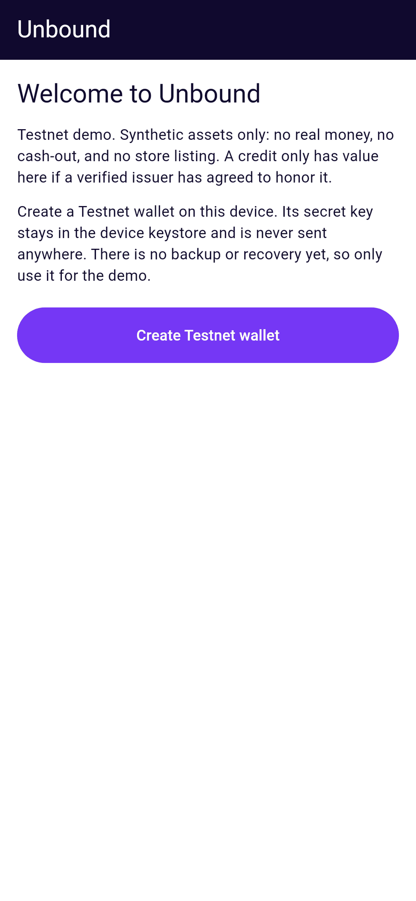
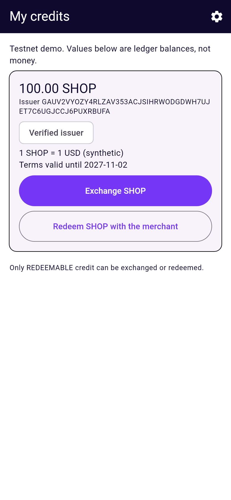
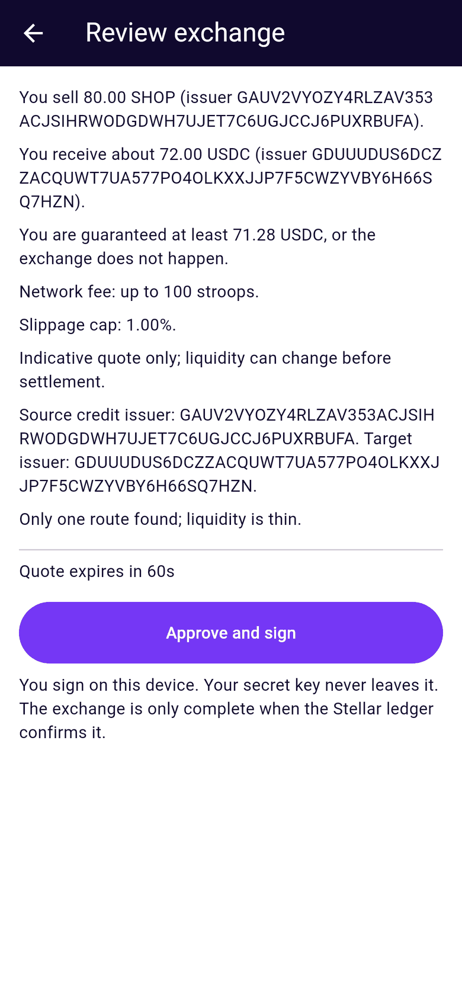
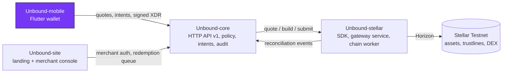

<div align="center">


# Unbound-mobile

**The Unbound wallet for Android and iOS: see what your store credit is worth, review a real quote, and sign on your own device.**

[](https://github.com/Unbound224/Unbound-mobile/actions/workflows/ci.yml)
[](./LICENSE)
[](https://developers.stellar.org/docs/networks)
[](#project-status)

Part of **[Unbound](https://github.com/Unbound224)** - turn stranded value into something usable.

</div>

<p align="center">
  
  
  
</p>
<p align="center"><sub>Headless renders of the real screens with synthetic Testnet fixtures (<code>tool/screenshots</code>), not device captures.</sub></p>

## What is Unbound?

Store credit is usually stuck inside one retailer. Unbound lets a person exchange store credit that a retailer has
**genuinely issued and agreed to honor** for other Stellar assets, at a real order-book quote that they sign on their
own device, or redeem it with the issuer.

- **Issuer-authorized only.** A verified merchant signs a redemption policy with its Stellar issuer key and must
  authorize every holder's trustline. No issuer, no usable credit; arbitrary gift cards are out of scope.
- **No fake liquidity.** Quotes come from real Stellar path payments, expire and carry a minimum-output floor. No route
  means no quote. Unbound never promises a price, liquidity or fiat cash-out.
- **Ledger-truthful.** Nothing is shown as settled until the ledger confirms it; unknown outcomes reconcile by hash.
- **Testnet only today.** Mainnet needs an external security review and legal/compliance work that has not happened.

## This repository

A Flutter app (Riverpod, go_router) that holds the user's Testnet key in the platform keystore and never sends it
anywhere. It shows credit inventory with issuer and redemption terms, requests quotes, **decodes the unsigned
transaction locally and checks it against the quote** before asking for biometric approval and signing, and tracks
exchange and redemption status honestly (pending, reconciling, confirmed, failed), surviving restarts.

## Architecture

Unbound is four independently tested repositories with one owner per boundary. This one is highlighted.



Clients never build Stellar transactions, and core never reimplements ledger logic. Details:
[`docs/ARCHITECTURE.md`](./docs/ARCHITECTURE.md) and [`docs/STELLAR_PROTOCOL.md`](./docs/STELLAR_PROTOCOL.md).

## Quickstart

Requires the Flutter stable SDK with Dart 3.13 or newer.

```bash
flutter pub get
dart format --output=none --set-exit-if-changed lib test
flutter analyze --fatal-infos
flutter test
flutter run --dart-define=API_URL=http://10.0.2.2:3001   # Android emulator -> a local Unbound-core
```

`flutter run` has not been exercised in the authoring sandbox (no emulator or Android SDK); the analyzer and the full
test suite, including widget journeys with real fixture XDR, run in CI.

## Android beta APK (releases)

Pushing a tag `v*` runs [`.github/workflows/release.yml`](./.github/workflows/release.yml): Java 17 + Flutter,
analyze, tests, `flutter build apk --release`, and a normal (latest, non-prerelease) release on
[GitHub Releases](https://github.com/Unbound224/Unbound-mobile/releases) with two assets whose names never change:
`unbound-android.apk` and `unbound-android.apk.sha256`. So this link always downloads the newest build (the site's
**Download for Android** button uses it):

    https://github.com/Unbound224/Unbound-mobile/releases/latest/download/unbound-android.apk

To install: allow "Install unknown apps" for your browser or file manager, open the APK, tap Install. Verify with
`sha256sum -c unbound-android.apk.sha256`. **This workflow has not run yet** (it was written without access to an
Android SDK), so the link resolves only after the first `v*` tag is pushed. The launcher name is "Unbound" and the
icon is generated from `brand/icon.svg` (checked by `test/brand_assets_test.dart`).

Signing: by default the APK is debug-signed (sideloading only; the release notes say which). To sign with your own key,
add these repository secrets:

| Secret | Value |
|---|---|
| `ANDROID_KEYSTORE_BASE64` | `base64 -w0 upload-keystore.jks` |
| `ANDROID_KEYSTORE_PASSWORD` | keystore password |
| `ANDROID_KEY_ALIAS` | key alias |
| `ANDROID_KEY_PASSWORD` | key password |

Optionally set the repository **variable** `UNBOUND_API_URL` to an HTTPS `Unbound-core` URL baked into the build;
otherwise the APK uses the emulator default, which does not work on a real phone. The app is not in any app store.

## Project status

Legend: **Built** = implemented and covered by automated tests in this repo. **Not yet** = not started or not verified.

| Layer | Status |
|---|---|
| Pure rules: exact `Amount`, strict contract models, `QuoteReview` (re-derived slippage floor), inventory, status text | Built |
| `ApprovalGuard` + `StellarXdrInspector`: local decode of the unsigned envelope compared with the quote | Built; tested on real XDR from `Unbound-stellar`'s builders |
| `SecureWalletSigner` (Android Keystore / iOS Keychain via `flutter_secure_storage`), Testnet only | Built; Dart signatures match the TypeScript fixture byte for byte. Platform keystore unverified on device |
| `LocalAuthApproval` (biometric / device credential, fails closed) | Written; unverified on device |
| `HttpCoreApi` and durable pending store | Built; tested against a loopback stub, not the real core |
| Screens: wallet gate, inventory, exchange, quote review with countdown, status, redemption, settings | Built; widget-tested incl. expiry, refusal, cancel, unknown outcome |
| Escrowed redemptions: local decode of the Soroban `open_return` / `expire_refund` (contract, function, wallet, issuer, amount, sha256 redemption key, deadline) before signing; escrow card, deadline, Check status, Take my credit back | Built; tested with real XDR from `Unbound-stellar`'s builders. Never run against a deployed contract |
| Wallet backup (recovery key behind acknowledgement + device approval) and restore from recovery key | Built; unit and widget tested. Android screenshot / recording / recents-thumbnail blocking (FLAG_SECURE) while the recovery key screen is open: channel code and tests built, **not verified on a device**; iOS has no equivalent and is not covered |
| Brand: app name, adaptive launcher icon, splash on brand ink | Built (generated with `flutter_launcher_icons`) |
| Release workflow: `v*` tag -> latest (non-prerelease) GitHub Release with fixed `unbound-android.apk` + `.sha256` | Written and guarded by a test; not run yet (no tag pushed) |
| `flutter build apk --release` on Windows (2026-11-04): succeeds (52.5 MB debug-signed APK) after fixing the plugin `compileSdk` (see CHANGELOG); never installed or run on a phone or emulator | Built; not run on a device |
| Device / integration tests, TalkBack/VoiceOver audit, localisation, push | Not yet |
| App Store / Google Play listings | Not yet: not in any store |

## Layout

`lib/domain` (pure rules) · `lib/flows` (orchestration and ports) · `lib/integrations` (HTTP, XDR, signer, stores) ·
`lib/app` + `lib/features` (Riverpod and screens) · `test/` (`test/support/fakes.dart` and `test/app/harness.dart` are
test adapters only) · `tool/` (brand icon rendering, README screenshots).

## The four repositories

| Repository | Owns | Stack | CI |
|---|---|---|---|
| [Unbound-core](https://github.com/Unbound224/Unbound-core) | Backend API: issuers, policies, intents, redemptions, audit | TypeScript, Node 22, SQLite | [](https://github.com/Unbound224/Unbound-core/actions/workflows/ci.yml) |
| [Unbound-stellar](https://github.com/Unbound224/Unbound-stellar) | Stellar SDK, gateway service, chain worker, Soroban redemption escrow | TypeScript, @stellar/stellar-sdk, Rust/Soroban | [](https://github.com/Unbound224/Unbound-stellar/actions/workflows/ci.yml) |
| [Unbound-site](https://github.com/Unbound224/Unbound-site) | Landing page, partner docs and merchant console | Next.js 16, React 19, Tailwind 4 | [](https://github.com/Unbound224/Unbound-site/actions/workflows/ci.yml) |
| [Unbound-mobile](https://github.com/Unbound224/Unbound-mobile) (this repo) | Flutter consumer wallet | Flutter, Dart, Riverpod | [](https://github.com/Unbound224/Unbound-mobile/actions/workflows/ci.yml) |

## Contributing and Drips Wave

Contributions are welcome. Start with [`CONTRIBUTING.md`](./CONTRIBUTING.md), then pick from the scoped, testable ideas in
[`docs/CONTRIBUTOR_ISSUES.md`](./docs/CONTRIBUTOR_ISSUES.md). Unbound intends to take part in
[Drips Wave](https://docs.drips.network/wave/maintainers/participating-in-a-wave/); that is subject to Drips' review and
limits, and no rewards are promised. Wave issues are opened only once their dependencies and acceptance tests are ready.
Everyone agrees to the [Code of Conduct](./CODE_OF_CONDUCT.md).

## Security

Please report vulnerabilities privately (Security tab, **Report a vulnerability**) as described in
[`SECURITY.md`](./SECURITY.md). The threat model is in [`docs/SECURITY.md`](./docs/SECURITY.md). Testnet only: never use
real funds, real customer data or Mainnet keys with this code.

## Documentation

[`docs/PRD.md`](./docs/PRD.md) (product) · [`docs/SRD.md`](./docs/SRD.md) (requirements, API, states) ·
[`docs/ARCHITECTURE.md`](./docs/ARCHITECTURE.md) · [`docs/TECHNICAL_BUILD.md`](./docs/TECHNICAL_BUILD.md) ·
[`docs/ROADMAP.md`](./docs/ROADMAP.md) · [`docs/BRAND.md`](./docs/BRAND.md) · [`AGENTS.md`](./AGENTS.md) (rules for coding agents).
The canonical copy of the shared docs lives in [Unbound-core](https://github.com/Unbound224/Unbound-core/tree/main/docs).

## License

[MIT](./LICENSE). The Unbound logo in [`brand/`](./brand) is the project's approved identity and is shared by all four
repositories; it has not been trademark-cleared.
